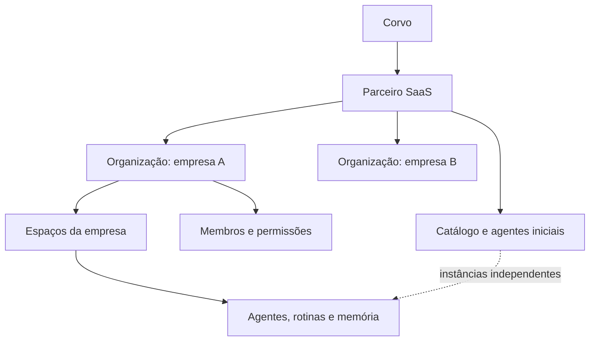

# Agentes incorporados para parceiros SaaS

Status: proposta de produto e arquitetura; não descreve uma funcionalidade já implementada.

Documento complementar: [Infraestrutura e custos dos ambientes de parceiros](2026-10-30-partner-runtime-infrastructure.md), com pesquisa de OpenBot/MausBot, fornecedores, provisionamento e critérios de validação.

## Objetivo

Permitir que um SaaS ofereça a experiência completa do Corvo dentro do próprio produto, com sua marca, seu login e suas regras comerciais. O acme-saas será o primeiro parceiro: cada barbearia poderá acessar sua equipe de IA sem criar uma senha separada no Corvo. A mesma integração deverá atender outros SaaS sem criar versões diferentes do produto para cada parceiro.

O parceiro conhece seus clientes, prepara agentes úteis para o segmento, decide quem pode usar o serviço e cobra por essa oferta. O Corvo fornece a execução, as interfaces compartilhadas, as integrações, o isolamento e a medição de consumo.

## Requisitos definidos

- O cliente acessa “Minha equipe AI” dentro do SaaS, com uma experiência equivalente à de um usuário autenticado no Corvo: agentes, conversas, memória, rotinas, integrações, acompanhamento de execuções e uso, respeitando seu papel e as capacidades habilitadas.
- O parceiro é a autoridade comercial sobre a habilitação de cada empresa cliente. O Corvo não exige uma assinatura própria do cliente final nem decide qual plano do parceiro deve dar acesso.
- O parceiro pode criar e selecionar agentes iniciais, preparar configurações para seu segmento e vender essa oferta aos seus clientes.
- As operações no sistema de origem são expostas por MCP, com autorização adequada para cada empresa, agente e operação.
- O parceiro pode cadastrar seu próprio conector e disponibilizá-lo automaticamente para cada empresa habilitada. Ao entrar, o usuário já encontra acesso aos dados autorizados do seu tenant, sem configurar MCP manualmente.
- Cada empresa também pode conectar bancos de dados e outros serviços necessários ao seu trabalho, conforme as capacidades habilitadas pelo parceiro, e selecionar quais agentes podem utilizar cada conexão.
- A loja existente do Corvo faz parte da experiência incorporada. A empresa usa essa mesma loja para descobrir e instalar outros conectores, sem precisar de um catálogo ou produto separado.
- O parceiro contrata uma oferta com franquia e limites por empresa; cada empresa pode ter limites por agente para evitar que uma execução consuma todo o saldo disponível.
- A oferta comercial será estruturada por quantidade de tenants e recursos incluídos. Preços e tamanhos definitivos dos pacotes ficam em aberto até medir custos e validar o valor da oferta; exemplos discutidos não constituem uma tabela comercial aprovada.
- Rotinas executam no backend mesmo sem o painel aberto. Todos os caminhos de execução respeitam habilitação, permissões e orçamento.
- O requisito inicial é operação 24/7. A referência posterior de máquina que inicia quando usada abre uma decisão sobre manter executor e computadores sempre ligados ou permitir retomada de componentes. Essa modalidade permanece pendente no documento de infraestrutura; não assumir economia por suspensão nem prometer máquina permanentemente ligada antes de defini-la. Suspensões comerciais, de segurança e por limites continuam sendo controles explícitos.
- A integração deve ser simples de instalar e reutilizável por outros parceiros.

As estruturas, nomes de endpoints e mecanismos abaixo são propostas de implementação. Valores comerciais, limites padrão e regras de publicação de agentes ainda precisam ser definidos antes da implementação correspondente.

## Responsabilidades

| Responsável | Decisões e controles |
| --- | --- |
| Parceiro SaaS | Quais empresas e usuários têm acesso; planos, preços e cobrança ao cliente; capacidades oferecidas; catálogo de agentes; agentes iniciais; teto de consumo por empresa; suspensão e reativação. |
| Administrador da empresa | Quem participa da equipe; agentes e rotinas dentro das capacidades contratadas; conexões e aprovações permitidas; distribuição de limites entre agentes, até o teto definido pelo parceiro. |
| Usuário da empresa | Uso dos agentes e recursos autorizados pelo seu papel. |
| Corvo | Aplicação das decisões do parceiro; autenticação da integração; isolamento; execução; contabilidade; limites técnicos; cobrança e prestação de contas ao parceiro. |

Habilitação comercial e disponibilidade de execução são estados diferentes. Uma empresa habilitada pelo parceiro pode estar temporariamente sem orçamento ou com uma conexão revogada. O Corvo informa a razão estruturada e não muda silenciosamente a decisão comercial do parceiro.

Suspensões técnicas da plataforma ou indisponibilidade de recursos também podem impedir execuções. Não representam uma segunda assinatura exigida da empresa. A interface direciona questões comerciais ao parceiro.

## Organização dos clientes e identidades



Cada empresa cliente corresponde a uma organização independente. Espaços continuam sendo divisões dessa organização, seguindo o modelo existente. O parceiro é uma entidade de distribuição, configuração e faturamento; não é uma organização única contendo todas as empresas clientes.

Mapeamentos propostos:

- `(partnerId, externalTenantId)` identifica uma única organização cliente.
- `(partnerId, externalUserId)` identifica uma identidade externa; suas participações em empresas são explícitas.
- A relação entre identidade, organização e papel é validada pelo backend, incluindo qual empresa está ativa na sessão.
- E-mail não vincula automaticamente contas de parceiros diferentes ou uma conta direta do Corvo.
- Criar novamente uma empresa, usuário ou conjunto inicial de agentes deve retornar os recursos existentes quando a operação for a mesma.

Ser o parceiro comercial não concede leitura automática de conversas, arquivos, segredos ou memória. Administração comercial, relatórios de consumo e eventual acesso de suporte são permissões distintas. Acesso de suporte deve ser explícito, limitado e auditado.

Uma mesma pessoa pode participar de várias empresas. A troca de empresa encerra o contexto anterior da interface e obtém uma nova autorização; histórico, eventos em tempo real e respostas atrasadas não podem aparecer no contexto novo.

## Experiência incorporada completa

O ponto de entrada proposto no SaaS é “Minha equipe AI”. Dentro dele, o cliente utiliza os mesmos fluxos e componentes do produto principal, filtrados por permissões e capacidades. O embed não deve virar um chat simplificado com funcionalidades próprias divergentes.

Inclui, conforme habilitação:

- Criar, configurar e usar agentes; instalar agentes do catálogo do parceiro.
- Acessar a loja existente para descobrir e conectar outros aplicativos e serviços.
- Conversar, acompanhar atividades e acessar resultados e arquivos.
- Configurar memória, ferramentas, conexões e trabalho em equipe.
- Criar, pausar, editar e acompanhar rotinas.
- Ver uso, saldo disponível, reservas pendentes e limites por agente.
- Aprovar ações, interromper execuções e entender impedimentos quando ocorrerem.
- Usar recursos adicionais do Corvo, como voz e computadores, quando configurados e permitidos.

Configurações globais da instalação, credenciais do parceiro e administração de outras empresas nunca fazem parte da experiência do cliente. Cobrança direta do Corvo é substituída pelo fluxo comercial do parceiro.

A marca do parceiro configura nome, logotipo e aparência por tokens sem bifurcar componentes. Informações técnicas e controles avançados aparecem somente onde forem necessários. A personalização não remove a explicação relevante sobre tratamento de dados e permissões de integrações.

O texto “Minha equipe AI” identifica a entrada pedida para a funcionalidade; é uma proposta de rótulo, não copy já adicionada à interface. Outros estados devem reutilizar os padrões existentes e mostrar detalhes apenas quando relevantes.

## Instalação e sessão

Um pequeno SDK JavaScript monta a interface incorporada. A integração também exige um endpoint no backend do parceiro; só um script público não é suficiente para atestar identidade e autorizações.

Exemplo ilustrativo de contrato futuro, com endereço fictício:

```html
<div id="agents"></div>
<script src="https://embed.example.com/v1/sdk.js"></script>
<script>
  Corvo.mount({
    container: "#agents",
    sessionEndpoint: "/api/agents/session"
  });
</script>
```

Fluxo proposto:

1. O usuário entra no SaaS e abre sua equipe de IA.
2. O SDK chama o endpoint do próprio SaaS, protegido pela sessão existente e pelas proteções aplicáveis a requisições autenticadas.
3. O backend obtém empresa, usuário e permissões a partir da sessão e dos seus registros; não confia nesses campos enviados livremente pelo navegador.
4. O backend autentica-se na API de parceiros do Corvo e solicita uma sessão para aquela identidade e empresa habilitada.
5. O Corvo cria ou encontra os vínculos necessários e emite um código temporário, de uso único, destinado ao embed e à origem autorizada.
6. O iframe troca esse código por uma sessão de curta duração e escopo restrito. O SDK administra renovação e encerramento sem depender de cookies de terceiros.

Credenciais do parceiro permanecem no servidor. Códigos e tokens não devem ir em URLs, logs ou armazenamento persistente desnecessário. Comunicação entre janela e iframe verifica origem exata, janela emissora e contrato da mensagem. Origens autorizadas e política de incorporação são configuradas por parceiro.

Logout, revogação de acesso, alteração de papel e troca de empresa invalidam o contexto correspondente. Tokens curtos não substituem a verificação de revogações no servidor. Bloquear novas sessões sozinho não suspende rotinas existentes.

O provisionamento pode ocorrer no cadastro da empresa ou na ativação do recurso pelo parceiro. Nenhum desses eventos deve iniciar trabalho pago implicitamente. Instalar agentes e começar suas rotinas são operações separadas.

## Habilitação controlada pelo parceiro

O backend do parceiro publica o estado desejado de acesso da empresa e suas capacidades. Pode usar uma API autenticada; notificações e sincronização devem ser idempotentes e versionadas para impedir que um evento antigo reative uma empresa suspensa.

Estados conceituais de habilitação: não habilitada, habilitada e suspensa. Orçamento esgotado, conexão inválida e capacidade indisponível são motivos de bloqueio de execução separados desses estados.

Ao suspender uma empresa:

- Negar novas execuções interativas, agendadas, por webhook ou por delegação.
- Revalidar trabalhos enfileirados antes de iniciar.
- Interromper novas etapas de trabalhos em andamento e solicitar cancelamento do que permitir cancelamento.
- Preservar histórico e conciliar custos já incorridos; suspensão não equivale a exclusão.
- Manter ou negar acesso de consulta conforme política explícita do parceiro.

Na reativação, não executar em massa todas as ocorrências de rotinas acumuladas durante a suspensão. Definir por tipo de rotina se a ocorrência é descartada, consolidada ou precisa de revisão. Não mudar silenciosamente a política atual de recuperação das instalações diretas do Corvo.

A implantação deve definir uma janela máxima verificável para propagar revogações. Não basta aguardar o vencimento de uma sessão longa. Se o serviço de autorização estiver indisponível e não houver estado válido, novas ações pagas ou com efeitos externos ficam bloqueadas, sem inventar uma autorização.

## Catálogo e agentes iniciais do parceiro

O parceiro pode criar agentes modelo, selecionar agentes existentes apropriados e montar um conjunto inicial para um segmento ou plano. A empresa recebe instâncias próprias: conversas, memória, rotinas, conexões e consumo não são compartilhados entre clientes.

Cada versão de um agente modelo pode definir:

- Nome, propósito, instruções e configuração inicial de modelo por conexões genéricas.
- Capacidades e ferramentas MCP requeridas, com permissões e aprovações esperadas.
- Rotinas sugeridas, inicialmente desativadas até uma ativação autorizada.
- Limites iniciais por agente e por execução, sempre subordinados à política vigente.
- Campos que a empresa precisa preencher e campos que pode personalizar.
- Versão, estado de publicação e compatibilidade com a oferta do parceiro.

Modelos não contêm credenciais, dados reais, memória de clientes ou identificadores de uma empresa específica. Durante a instalação, as conexões são vinculadas à empresa de destino. Instalar um agente não autoriza automaticamente novas ferramentas.

O parceiro escolhe quais modelos entram no primeiro acesso e quais aparecem no catálogo. A instalação é idempotente por empresa e identificador de instalação: repetir um login não duplica agentes e rotinas.

Publicar uma nova versão não sobrescreve silenciosamente instruções personalizadas, memória ou rotinas do cliente. A instância registra sua versão de origem. Atualizações precisam apresentar alterações e preservar personalizações; aumento de permissões requer nova autorização. Revogar uma ferramenta por segurança é uma política separada de atualizar o modelo.

O parceiro pode vender o conjunto como parte de um plano, como adicional ou por agente habilitado. O catálogo expressa quais capacidades estão incluídas; o SaaS realiza a venda e informa a habilitação ao Corvo. Desabilitar um agente pago preserva seus dados e interrompe sua execução, sem apagar o histórico.

Exemplos propostos para o acme-saas:

| Agente inicial | Trabalho | Ferramentas necessárias |
| --- | --- | --- |
| Gestão | Consultar agenda e preparar resumo operacional. | Leitura de agenda, serviços e relatórios autorizados. |
| Recepção | Consultar disponibilidade e criar ou reagendar atendimentos. | Consulta e escrita de agendamentos, com as regras do sistema. |
| Relacionamento | Preparar ações de contato e acompanhar retornos. | Consultas autorizadas e envio somente quando permitido. |

Esses exemplos não afirmam que os servidores MCP ou ferramentas já existem. A primeira entrega valida um conjunto pequeno de operações reais antes de ampliar o catálogo.

## Conector próprio do parceiro e conexões adicionais

O parceiro cadastra uma definição reutilizável do seu conector: nome, endpoint MCP, ferramentas disponíveis, requisitos de autorização e política de provisionamento. O Corvo fornece o cadastro e o ciclo de vida da conexão; o parceiro implementa ou disponibiliza o servidor que expõe as operações do seu sistema. Cadastrar um endereço não cria automaticamente as ferramentas nem o acesso aos dados.

Essa definição pode permanecer privada para as empresas do parceiro. Não precisa entrar em um catálogo público para funcionar. Cada empresa recebe uma instalação vinculada ao seu contexto, com autorizações próprias; a definição é compartilhada, mas a sessão de acesso, os dados e os segredos não são.

### Acesso preparado ao entrar no SaaS

1. O parceiro cadastra o conector uma vez e o associa às capacidades e aos agentes iniciais da sua oferta.
2. Ao habilitar a empresa, seu backend provisiona a instalação do conector e a delegação autorizada para aquele tenant. Se necessário, essa preparação pode acontecer no primeiro acesso de maneira idempotente.
3. Ao abrir a equipe de IA, o backend identifica usuário e empresa pela sessão autenticada e resolve a instalação correspondente.
4. Antes de executar uma ferramenta, o backend obtém uma credencial limitada àquela empresa, ao principal da operação e aos escopos permitidos, usando o mecanismo de autorização acordado com o servidor MCP.
5. O servidor do parceiro valida a credencial e aplica as regras de acesso do próprio SaaS antes de consultar ou alterar dados.

No acme-saas, isso significa abrir a equipe de IA e poder consultar os dados autorizados da barbearia sem informar uma URL MCP, copiar uma chave ou fazer outro login. A preparação automática é autorizada pela política do parceiro; operações que exigem autorização adicional continuam exigindo-a.

O login no embed não deve ser reutilizado como um token universal para todas as ferramentas. A credencial da API de parceiros também não deve ser entregue ao agente como acesso global aos tenants. As autorizações das ferramentas são específicas para o recurso de destino e podem ser revogadas independentemente da sessão da interface.

A instalação da empresa não torna todos os seus dados acessíveis a todos os funcionários. Execuções interativas respeitam o papel da pessoa; rotinas usam a delegação de serviço explicitamente concedida. Credenciais temporárias, pools de conexão e caches precisam separar tenant e contexto de autorização para não reaproveitar o acesso de uma pessoa com mais permissões para outra com menos permissões.

Agentes iniciais declaram qual conector precisam. Na instalação, essa referência é resolvida para a conexão da empresa, sem IDs ou credenciais fixados no modelo. Caso a preparação falhe ou o acesso seja revogado, o agente informa que a conexão precisa ser resolvida; não usa dados de exemplo como se fossem dados reais nem tenta uma credencial mais abrangente.

### Outros conectores da empresa

Além da conexão do SaaS, a empresa acessa a loja existente do Corvo dentro da experiência incorporada para instalar conectores para bancos de dados, arquivos, calendários, comunicação, sistemas financeiros e outros serviços disponíveis. São reutilizados a mesma fonte de catálogo, busca, detalhes, fluxos de autorização e gerenciamento de conexões. A loja faz parte da oferta completa ao cliente; não é um catálogo novo por parceiro.

O conector do parceiro aparece entre as conexões instaladas, preparado para o tenant. Para adicionar outro serviço, a pessoa abre a loja, escolhe o conector, autoriza sua conta quando necessário e o disponibiliza aos agentes permitidos. O login no SaaS não concede automaticamente acesso às contas da empresa em serviços externos.

O catálogo compartilhado pode ser complementado por entradas privadas do parceiro, visíveis somente às suas empresas, reutilizando os contratos da loja. A curadoria e eventuais restrições da oferta são aplicadas sobre essa mesma base. Atualizações do catálogo compartilhado ficam disponíveis aos parceiros sem copiar a loja; uma nova entrada ou versão nunca instala uma conexão nem amplia permissões automaticamente.

Reutilizar a arquitetura documentada em [Built-in app catalog](2026-10-27-app-catalog-design.md) e os fluxos existentes de conexão. A publicação e o provisionamento automático de entradas privadas são extensões propostas, não funcionalidades presumidas como já implementadas. Serviços sem conector disponível podem usar o caminho de conexão personalizada suportado pelo produto.

Há três origens possíveis, com o mesmo modelo de permissões:

| Origem | Instalação e autorização |
| --- | --- |
| Conector do parceiro | Preparado automaticamente por empresa, dentro da delegação concedida pelo parceiro. |
| Conector da loja existente | Descoberto e selecionado pela empresa na mesma loja do Corvo, autorizado com suas próprias credenciais pelo fluxo suportado. |
| Conector personalizado | Cadastrado por um administrador autorizado da empresa, via MCP ou outro mecanismo suportado pelos contratos compartilhados. |

O parceiro habilita a capacidade de adicionar conexões e pode restringir categorias ou capacidades da oferta. Dentro desse limite, a empresa decide quais serviços conectar e quais agentes podem usá-los. Uma conexão pertence ao contexto da empresa e é disponibilizada apenas aos espaços e agentes selecionados, conforme o modelo de escopo existente; não é herdada por outras empresas do parceiro.

Para bancos de dados, usar uma integração controlada, como um servidor MCP ou adaptador específico, com credenciais de menor privilégio. A configuração inicial proposta é somente leitura, com acesso explícito a bases, schemas, tabelas ou operações permitidas. Escrita exige habilitação separada e as aprovações aplicáveis. Autorização é aplicada pelo servidor e pelo banco, não por uma instrução no prompt.

Conexões a bancos precisam de limites de tempo, volume de resultados e concorrência. Isolamento por tenant continua obrigatório quando várias empresas compartilham a mesma base: uma chave administrativa comum e um filtro que o modelo pode omitir não são uma fronteira de isolamento. Bancos privados exigem um caminho de rede autorizado; cadastrar uma conexão não autoriza contornar as políticas de rede da instalação.

Credenciais são mantidas no servidor, protegidas em armazenamento e ocultas dos agentes e do frontend. Rotação ou revogação interrompe novas chamadas e informa as dependências afetadas. Remover uma conexão não remove automaticamente os dados que já foram copiados para conversas, arquivos ou memória; a gestão desses dados deve seguir a política de retenção e exclusão da empresa.

Cada chamada mantém atribuição de uso e efeitos por conexão, agente e execução. Limites da empresa e do agente também valem para conectores adicionais; custos externos que não podem ser limitados pelo Corvo precisam ter tratamento explícito. Nenhum agente instala novas conexões ou amplia escopos por conta própria.

## Acesso aos sistemas por MCP

O SaaS expõe suas operações como ferramentas MCP e continua sendo a autoridade sobre seus próprios dados e regras. O agente pode operar todas as funcionalidades expostas para as quais tenha autorização, sem receber poder administrativo global por padrão.

São duas autenticações distintas:

1. A pessoa acessa a experiência do Corvo pela identidade do SaaS.
2. O agente recebe uma autorização delegada para chamar ferramentas daquele SaaS.

O provisionamento pode preparar a conexão automaticamente quando o parceiro tem autoridade para concedê-la. Integrações que exigem autorização do cliente exibem seu fluxo de conexão. O agente não precisa conhecer a senha da pessoa nem simular seu login para usar uma API.

O backend vincula a conexão ao parceiro, empresa, espaço e conjunto de permissões adequado. Segredos são guardados no servidor, não em prompts ou no JavaScript. Cada chamada deve identificar um principal autorizado, com escopos e validade apropriados; o formato específico depende do servidor MCP e do mecanismo de autorização suportado.

Regras obrigatórias:

- O servidor MCP deriva a empresa da credencial validada. Um argumento `tenantId` produzido pelo modelo não amplia acesso.
- Permissões do principal, instalação da ferramenta, política do agente e aprovações da ação se intersectam; nenhuma camada concede o que outra negou.
- Rotinas usam uma delegação durável e revogável, concedida por um administrador, sem depender de um navegador aberto. Desabilitar a empresa ou revogar essa delegação bloqueia novas ações.
- Trabalho em nome de uma pessoa respeita a revogação dessa pessoa. Transferir uma rotina para uma identidade de serviço exige uma autorização explícita, sem promoção automática de privilégios.
- Respostas de ferramentas e conteúdo externo são dados, nunca autoridade para trocar de empresa, elevar privilégios, aumentar orçamento ou instalar ferramentas.
- Ações com efeitos externos usam idempotência quando suportada. Após timeout, consultar o resultado antes de repetir; não presumir que uma falha de transporte significa que nada aconteceu.
- Endpoints MCP são cadastrados por atores autorizados, validados e submetidos às políticas de rede existentes. Uma descrição de ferramenta não concede acesso à rede interna do host.

Para disponibilizar outras integrações, reutilizar contratos compartilhados e adaptadores, mantendo fornecedores opcionais. O core continua executável sem depender de um fornecedor hospedado específico.

## Modelo comercial e contabilização

O parceiro contrata um plano do Corvo definido por quantidade de tenants e recursos incluídos, com franquia e política de consumo. Decide como repassar esse custo e o valor dos agentes aos seus clientes. O cliente final acompanha seu uso dentro do SaaS e não precisa contratar diretamente o Corvo. Não há preços aprovados nesta proposta.

Existem dois relacionamentos separados:

- Corvo → parceiro: pacote de tenants, recursos incluídos, franquia, consumo, limites e eventual excedente autorizado.
- Parceiro → empresa: plano, preço, agentes incluídos, limites e cobrança definidos pelo SaaS.

A ativação da empresa não é inferida de uma assinatura direta no Corvo. As verificações de cobrança existentes precisam distinguir organizações diretas e organizações atendidas por parceiro, sem permitir que um caminho contorne orçamento ou autorização.

No início, a proposta é usar uma franquia compartilhada do parceiro com tetos por empresa. Um teto limita consumo; não reserva uma parcela exclusiva da franquia. Se o parceiro quiser garantir saldo para determinadas empresas, usar alocações explícitas que reduzam o saldo livre, sem contar o mesmo crédito duas vezes.

Excedente e recarga automática ficam desabilitados por padrão. Somente uma decisão explícita do parceiro pode habilitá-los, com teto definido. Esgotar créditos nunca dispara uma compra ilimitada.

Registrar atribuição por parceiro, organização, espaço, agente, rotina, execução e operação. Guardar também a origem da execução, o iniciador quando aplicável, modelo/provedor, unidades, preço aplicado e estado de conciliação. Exclusão de um agente não apaga o consumo já ocorrido.

Separar custo de fornecedor, crédito debitado e preço comercial do parceiro. O cliente pode ver créditos sem conhecer a margem do parceiro. Conversões de unidades usam uma versão de preço identificável; valores financeiros de controle usam precisão inteira ou decimal definida, sem depender de soma em ponto flutuante.

Definir explicitamente quais recursos entram na franquia: chamadas de modelo, voz, computadores, armazenamento e ferramentas externas podem ter custos diferentes. Custos cobrados diretamente por terceiros não aparecem como zero nem são apresentados como cobertos por um limite que o Corvo não consegue aplicar.

### Pacotes por tenants e recursos

A direção comercial é oferecer um pacote de entrada com um número limitado de empresas, pacotes maiores conforme a escala e uma contratação negociada para necessidades específicas. Quantidades, valores e recursos de cada faixa serão definidos após o piloto. Não publicar preços provisórios como compromisso nem codificá-los nas regras de domínio.

Cada plano precisa distinguir:

- Quantidade de tenants habilitados incluída e regra para expandir essa capacidade.
- Capacidades disponíveis, como rotinas, voz e computadores, com limites de concorrência e armazenamento quando aplicáveis.
- Consumo incluído e sua unidade de medição, sem sugerir uso ilimitado apenas porque o tenant está incluído.
- Política de excedente, recarga ou bloqueio, sempre explícita.

Recomendação inicial a validar: contar organizações clientes habilitadas, sem multiplicar a contagem por usuários, agentes ou espaços da mesma empresa. Manter separadas a decisão do parceiro de habilitar uma empresa e a capacidade contratada para acomodar essa habilitação. Ao atingir a capacidade, a API informa o limite e exige uma alteração autorizada do plano; não ativa cobrança adicional silenciosamente.

Antes de cobrar, definir a regra temporal da contagem: quantidade simultânea, pico do período ou tempo proporcional de habilitação. Suspender e reativar não pode apagar consumo passado nem permitir reutilização ilimitada de vagas sem uma regra comercial clara. Empresas suspensas podem continuar gerando custo de retenção; suspensão não implica exclusão imediata de armazenamento ou backups.

### Medição de custo antes da precificação

Um tenant é uma fronteira de organização e isolamento; não precisa corresponder a um servidor dedicado. Na arquitetura compartilhada, parte da infraestrutura é comum e parte varia com armazenamento, trabalho executado e concorrência. Portanto, não presumir que todas as empresas têm o mesmo custo fixo.

Para os componentes mantidos 24/7, estimar capacidade durante todo o mês, além do consumo variável. Para componentes sob demanda, caso essa modalidade seja escolhida, medir tempo ativo, persistência e retomada separadamente. Avaliar ambientes de execução isolados por tenant, com recursos limitados, sem assumir ainda servidor físico exclusivo, provedor ou implementação do provisionador. Incluir capacidade de recuperação, armazenamento e operação na comparação; executar permanentemente uma única instância não oferece, por si só, alta disponibilidade.

Para avaliar a oferta, separar:

| Componente | O que medir ou estimar |
| --- | --- |
| Infraestrutura compartilhada | API, workers, banco, filas e serviços comuns; documentar o critério de rateio sem duplicar custos. |
| Persistência por tenant | Dados, arquivos, memória, backups e retenção, inclusive quando não há execução. |
| Execução variável | Modelos, voz, computadores, tempo de processamento e integrações com cobrança. |
| Capacidade reservada | Concorrência, recursos dedicados e folga necessária para picos, quando contratados. |
| Operação | Suporte, manutenção e incidentes; estimativas separadas de despesas diretamente medidas. |

Uma visão de custo por tenant combina custos diretamente atribuíveis com sua parcela dos custos compartilhados. O total rateado precisa reconciliar com o custo da instalação; não somar novamente um custo de fornecedor já incluído no ledger. Créditos debitados ao cliente não substituem a medição de custo real.

Durante o piloto, observar empresas com uso leve e intenso, rotinas com painel fechado, execuções concorrentes e dados mantidos sem atividade. Comparar custo médio com os casos de maior consumo e com o custo marginal de adicionar empresas; a média sozinha não dimensiona a franquia nem os tetos.

O custo define uma base de sustentabilidade. O preço também depende do trabalho que os agentes resolvem, do valor para o parceiro e do espaço para ele compor sua própria oferta. A decisão de valores vem depois dessa validação, sem fixar um multiplicador ou margem nesta especificação.

Medições reais e informações comerciais ficam em relatórios privados de operação, fora deste repositório público. O código e a documentação usam apenas contratos, critérios e exemplos fictícios. Antes de automatizar cobrança, validar a medição em modo de simulação e reconciliar os resultados; os limites de segurança continuam ativos durante o piloto.

## Limites por agente e proteção contra consumo descontrolado

Uma execução precisa caber em todos os limites aplicáveis. Habilitação não significa orçamento ilimitado.

| Escopo | Controles propostos |
| --- | --- |
| Parceiro | Saldo total, teto do período, excedente autorizado e concorrência agregada. |
| Empresa | Teto diário e por período, capacidades e concorrência. |
| Agente | Teto diário e por período, concorrência, permissões e pausa manual. |
| Rotina | Frequência mínima, limite por ocorrência e política de repetição. |
| Execução e suas delegações | Custo máximo acumulado, duração, etapas, chamadas de ferramentas, tentativas e profundidade de delegação. |

O parceiro define tetos e padrões. O administrador da empresa pode distribuir ou reduzir limites dentro desse envelope. Agentes não podem aumentar seus próprios limites, reativar-se ou autorizar compras. Criar um agente novo não aumenta o orçamento da empresa; agentes recém-criados recebem limites conservadores obrigatórios.

Orçamentos por agente são compartilhados entre todos os seus chats, rotinas e execuções. Não basta limitar cada conversa separadamente. O limite da execução raiz inclui subagentes, delegações e tentativas; delegar não cria orçamento novo. Cada custo é registrado uma vez, atribuído ao executor e agregado na raiz sem duplicação financeira.

Definir janelas de orçamento, fuso, início/fim do período e política de renovação explicitamente. Reservas em andamento continuam vinculadas ao período em que foram admitidas; virar o dia ou o mês não libera saldo comprometido nem permite debitar uma reserva duas vezes.

### Reserva antes de gastar

1. Revalidar habilitação, permissões e todos os limites antes de admitir a execução.
2. Antes de cada operação cobrável, reservar atomicamente um valor que cubra seu custo máximo permitido em todos os escopos necessários.
3. Executar a operação com limites efetivos, como saída máxima do modelo e duração máxima de recursos medidos por tempo.
4. Conciliar o custo real, debitar uma única vez e liberar apenas a sobra confirmada.
5. Repetir a verificação antes da próxima etapa; o estado do painel não é uma autorização.

O saldo disponível considera consumo liquidado e reservas em aberto. Duas execuções concorrentes não podem reservar o mesmo saldo. A reserva na hierarquia precisa ser transacional ou ter uma garantia equivalente verificável, sem estados parciais que permitam gastar em outro nível.

Uma falha ou timeout não devolve automaticamente a reserva: o fornecedor pode ter executado e cobrado. Manter a operação em conciliação até confirmar seu resultado; recuperações após queda do worker usam identificadores idempotentes e ownership válido. O cliente vê valores pendentes separados do consumo confirmado.

Operações cujo custo máximo não possa ser limitado não são elegíveis para uma promessa de teto rígido. Devem ser bloqueadas nesse modo ou ter uma política explícita de exposição máxima. Cancelar uma chamada não garante estorno; custos já incorridos e cobranças externas precisam ser contabilizados.

### Detecção e interrupção de falhas

- Limitar tentativas, tempo de execução, chamadas de ferramentas e saltos de delegação, mesmo quando houver créditos disponíveis.
- Aplicar pausa por repetição de falhas estruturadas, como timeouts consecutivos e autenticação rejeitada; não usar palavras da resposta do modelo como prova de sucesso ou fracasso.
- Interromper novas etapas quando o limite de custo ou de tempo for atingido, preservando resultados e estado recuperável.
- Não reiniciar automaticamente um agente pausado por falha recorrente. Exigir revisão autorizada para retomar; orçamento renovado sozinho não resolve a falha.
- Limitar concorrência e usar distribuição justa de trabalhos para que um agente ou empresa não ocupe todos os recursos do parceiro.
- Reconciliar e encerrar recursos que geram custo contínuo, como computadores, conforme política explícita de inatividade e prazo máximo. Interromper o chat sozinho não interrompe necessariamente esses custos.

Estados estruturados distinguem bloqueio comercial, orçamento esgotado, pausa manual, falha recorrente e conexão revogada. A interface mostra o motivo e a ação permitida somente quando necessário.

## Estruturas e contratos propostos

Reaproveitar `Organization`, `Space`, `Member`, `SpaceMember`, `Bot`, `Routine`, `Connection`, `McpServer`, `UsageRecord` e as estruturas de crédito já existentes. O schema contém atribuição de uso por agente e estruturas de reserva/conciliação; isso não significa que limites hierárquicos de parceiros já estejam implementados.

Novas responsabilidades persistidas, com nomes finais a decidir:

| Estrutura conceitual | Responsabilidade |
| --- | --- |
| Parceiro | Marca, origens permitidas, credenciais da integração, configuração comercial e estado operacional. |
| Vínculo de empresa externa | Mapeamento exclusivo para organização, estado de habilitação e versão da política do parceiro. |
| Identidade externa | Mapeamento de usuário e vínculos autorizados, sem união implícita por e-mail. |
| Modelo de agente e versão | Catálogo do parceiro, capacidades requeridas e configuração inicial sem segredos. |
| Instalação de modelo | Origem e versão da instância, personalizações e idempotência de provisionamento. |
| Definição de conector do parceiro | Endpoint, ferramentas, requisitos de autorização, visibilidade e política de provisionamento, reutilizando o catálogo e os contratos de integração existentes. |
| Instalação e delegação de conector | Vínculo com empresa e escopo de acesso, estado de provisionamento e referências às conexões e credenciais existentes, sem duplicar segredos. |
| Política e reserva de orçamento | Tetos por escopo, reservas, conciliação e referências ao ledger existente. |

Contratos da API de parceiros precisam cobrir provisionamento idempotente, publicação de habilitação/capacidades, criação de sessão, suspensão, consulta de uso, configuração de limites, instalação de agentes e cadastro/provisionamento de conectores próprios. Todos os recursos ficam limitados ao parceiro autenticado. Credenciais têm escopos, rotação e revogação; APIs de parceiro e sessões de usuário não são intercambiáveis.

Eventos de saída podem informar uso consolidado, limite atingido, pausa e estado de provisionamento. Devem ter assinatura, identificador estável, versão e repetição com backoff. Consumidores toleram duplicação e eventos fora de ordem. Consultas de reconciliação recuperam notificações perdidas sem criar um segundo registro financeiro.

## Organização da implementação

- `packages/contracts`: contratos de parceiros, habilitação, orçamento, catálogo e embed.
- `packages/core`: regras de provisionamento, autorização, limites, execução e composição de agentes iniciais.
- `packages/db`: persistência e isolamento, com migrações aditivas compatíveis com a versão anterior.
- `packages/adapters`: mecanismos externos de identidade, cobrança e integração; sem dependência de fornecedor no domínio.
- Web: modo incorporado e SDK fino, reutilizando componentes existentes, a mesma API e a loja com seus fluxos de descoberta, instalação e autorização.
- Electron: mantém a experiência web compartilhada; políticas de acesso e orçamento também se aplicam se uma identidade de parceiro acessar essa superfície.
- Mobile: reutiliza contratos e políticas do backend em interface nativa. O script DOM é específico de navegadores; integração de login/entrada nativa exige um fluxo próprio. Até existir, não prometer que colar o script incorpora a experiência em qualquer app nativo.

Mudanças de política valem em todas as superfícies e gatilhos. Uma sessão direta, um webhook ou uma rotina não pode contornar uma restrição aplicada no embed.

## Entrega incremental

1. **Identidade e habilitação:** cadastrar o primeiro parceiro pelo caminho genérico; mapear organizações e usuários; aplicar suspensão e revogação; testar isolamento antes de expor dados reais.
2. **Experiência completa incorporada:** sessão, marca, navegação e fluxos compartilhados, sem cobrança direta ao cliente final.
3. **Orçamento desde o piloto:** reservas atômicas, teto por empresa/agente/execução, interrupção, conciliação e consulta de uso. Não liberar rotinas pagas sem esses controles.
4. **MCP e agentes iniciais:** cadastrar o conector do acme-saas, provisionar acesso automático por tenant, instalar agentes próprios por empresa, validar aprovações e ativar rotinas de forma autorizada. Validar também uma conexão adicional da empresa pelo fluxo compartilhado.
5. **Operação para parceiros:** catálogo versionado, APIs de habilitação e limites, prestação de contas e eventos para o SaaS.
6. **Validação com outro SaaS:** integrar um segundo parceiro usando os mesmos contratos; identificar diferenças de configuração sem criar condicionais específicas do acme-saas no core.

## Critérios de aceite

- Uma pessoa autenticada no SaaS acessa sua equipe sem uma segunda senha e encontra os recursos contratados, incluindo rotinas e uso.
- Somente o parceiro habilita comercialmente a empresa; não há exigência de assinatura Corvo individual nesse fluxo.
- Suspensão bloqueia chat, rotinas, filas, eventos e delegações, inclusive com sessões antigas; o prazo de propagação é documentado e testado.
- Trocar IDs no navegador, em ferramentas ou em eventos não permite acessar outra empresa ou parceiro.
- Duas empresas instalando o mesmo agente modelo recebem instâncias, conexões e memórias independentes.
- Repetir provisionamento ou instalação não duplica recursos; atualizar um modelo não apaga personalizações nem eleva permissões sem autorização.
- Um agente atinge seu próprio limite sem consumir o orçamento restante dos demais; nenhuma combinação de concorrência, tentativas e delegações ultrapassa a reserva autorizada.
- Uma chamada com resultado desconhecido mantém sua reserva até conciliação; reiniciar workers não duplica cobrança nem libera saldo comprometido.
- Limites se aplicam na virada de período, em reativação, em execução agendada e em recursos de custo contínuo.
- Revogar uma conexão MCP bloqueia novas operações; ferramentas não podem escolher outra empresa por argumento.
- Ao entrar em uma empresa habilitada, o usuário encontra o conector do parceiro pronto e consulta dados reais autorizados do tenant sem configurar MCP ou informar credenciais manualmente.
- O mesmo conector atende empresas distintas com contextos isolados; um funcionário não herda permissões de administrador por compartilhar a instalação ou um cache.
- A empresa adiciona uma conexão própria a banco de dados ou outro serviço e concede acesso somente aos agentes escolhidos, respeitando as capacidades habilitadas pelo parceiro.
- A loja existente está acessível dentro do embed e usa o mesmo catálogo e fluxo de conexão do produto principal; o conector preparado pelo parceiro aparece instalado e novas conexões ficam restritas à empresa que as autorizou.
- Uma conexão de banco configurada como somente leitura rejeita escritas no servidor ou no banco, independentemente do pedido do agente. Revogação bloqueia novos acessos também nas rotinas.
- Uso permanece auditável após excluir um agente, separando realizado, reservado e pendente de conciliação.
- Um segundo SaaS usa os mesmos contratos sem lógica específica de parceiro no core.

Os testes de autorização, isolamento, orçamento, idempotência e recuperação serão determinísticos e offline por padrão, com provedores simulados e banco local quando necessário. Avaliar a utilidade dos agentes em linguagem natural exige avaliações opcionais com LLM, rubrica versionada e custo separado. A implementação de UI terá cobertura web e screenshot de CI; o e2e de Electron permanece no ambiente de CI.

## Decisões ainda necessárias

- Quais capacidades, agentes iniciais e operações MCP entram na primeira oferta.
- Unidade de crédito, composição da franquia, renovação e custos que ficam fora dela.
- Quantidade de tenants e recursos de cada pacote, regra temporal de contagem, tratamento de suspensão e expansão de capacidade; preços somente após medir custos e validar valor.
- Tetos e concorrência padrão por empresa, agente e execução, incluindo tratamento de períodos e reservas.
- Se haverá saldo garantido por empresa ou somente tetos sobre a franquia compartilhada.
- Política de consulta após suspensão, retenção e encerramento de dados, e acesso de suporte delegado.
- Como distribuir atualizações dos agentes modelo e quais configurações o parceiro pode administrar nas instâncias.
- Prazo máximo de propagação de revogação e política de retomada de cada tipo de rotina.

Essas decisões não alteram os princípios já definidos: a oferta e a habilitação pertencem ao parceiro, os agentes e dados pertencem ao contexto de cada empresa, e nenhuma execução pode ignorar os limites e permissões aplicáveis.
