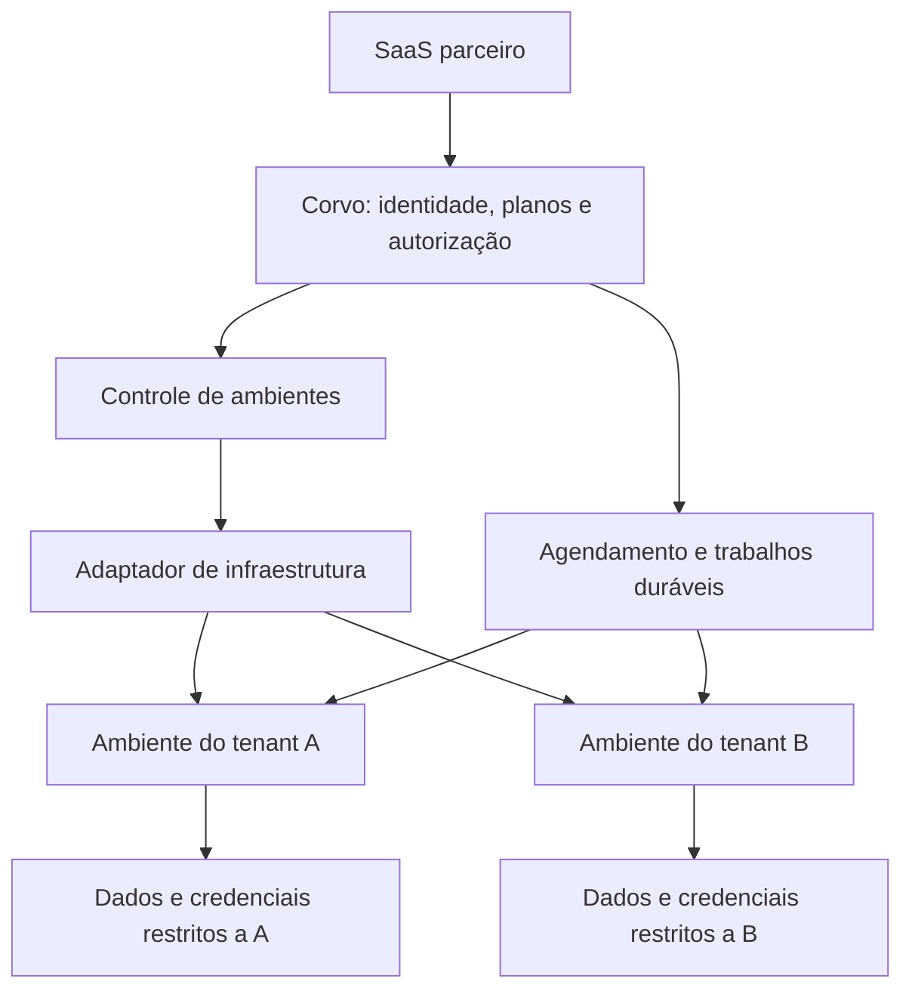

# Infraestrutura e custos dos ambientes de parceiros

Data de referência da pesquisa: 30 de outubro de 2026.

Status: documento de referência e proposta de validação. Nenhuma infraestrutura foi contratada ou implantada por este documento. Preços de fornecedores são referências públicas, não uma cotação nem preços aprovados do Corvo.

Direção inicial: manter o controle dos ambientes no backend do Corvo e avaliar os adaptadores existentes, sem criar um projeto separado de infraestrutura. Boat é opcional. Para operação própria, começar pela avaliação do adaptador Kubernetes; a compatibilidade de um provedor de hospedagem depende das permissões e capacidades disponíveis.

Complementa [Agentes incorporados para parceiros SaaS](2026-10-30-partner-embedded-agents-design.md), que define identidade, habilitação pelo parceiro, loja, MCP, agentes iniciais e limites financeiros.

## 1. O produto que queremos sustentar

O parceiro oferece uma equipe de IA dentro do seu SaaS. Cada empresa cliente tem agentes, rotinas, dados, conexões e consumo próprios. O acme-saas será o primeiro parceiro, usando os mesmos contratos disponíveis aos próximos SaaS.

A oferta será organizada por quantidade de tenants e recursos. O parceiro decide quais empresas podem usar e como cobrar delas. O Corvo administra a execução e aplica permissões, limites e contabilização.

Queremos ambientes isolados com recursos controlados, provisionados automaticamente. Não queremos depender de configurar manualmente uma VPS para cada cliente. Ainda não foi escolhido se o isolamento envolverá somente computadores, o executor completo ou uma instalação inteira por empresa.

O requisito inicial foi operação 24/7. Depois foi apresentada como referência uma oferta de máquina Linux que inicia quando usada. Isso exige uma decisão explícita sobre quais componentes permanecem ligados. Não assumir que a referência substituiu o requisito anterior nem prometer economia por suspensão antes de definir a modalidade.

## 2. Separar os componentes antes de escolher o fornecedor

| Componente | Função | Precisa de um desktop Linux? |
| --- | --- | --- |
| Plataforma de controle | Parceiros, sessões, habilitação, planos, limites, catálogo e registro dos ambientes. | Não. |
| Agendamento e entrada de eventos | Receber mensagens e webhooks, manter trabalho pendente e acionar rotinas. | Não. |
| Executor dos agentes | Coordenar chamadas de modelo, ferramentas, memória e progresso das tarefas. | Não para todo trabalho. |
| Computador do agente | Navegador, terminal, programas e arquivos de trabalho. | Sim, quando essas capacidades são usadas. |
| Persistência | Conversas, memória, arquivos, credenciais e histórico de uso. | Precisa sobreviver à substituição dos processos e máquinas. |

Consultar uma agenda por MCP não exige necessariamente iniciar um computador gráfico. Uma tarefa pode precisar de executor e conexão, mas não de Chrome ou desktop.

Não confundir máquina dedicada ao tenant com servidor físico exclusivo. Um ambiente pode ser uma VM isolada em hardware compartilhado. Também não confundir limite de CPU com CPU exclusivamente reservada: quota, reserva e possibilidade de pico precisam ser definidos pelo fornecedor.

## 3. O que significa 24/7

| Modalidade | O que fica ligado | O que pode parar | Consequência |
| --- | --- | --- | --- |
| Ambiente sempre ligado | Executor e computadores contratados, além do controle. | Somente por política explícita ou manutenção. | Capacidade computacional permanente entra no custo mensal. |
| Executor sempre ligado | Controle, agendamento e executor. | Computadores ociosos. | Rotinas seguem funcionando; tarefas gráficas podem esperar inicialização. |
| Ambiente sob demanda | Controle e mecanismos de entrada/agendamento. | Executor e computadores do tenant. | Uma chamada externa precisa acordar o ambiente e entregar o trabalho pendente. |

Disponibilidade da funcionalidade 24/7 não significa que todos os seus processos precisam consumir CPU durante todo o mês. Porém, uma oferta que promete máquina permanentemente ligada deve dimensionar e pagar por isso.

Uma única instância sempre ligada também não equivale a alta disponibilidade. É necessário definir recuperação, armazenamento, capacidade de reposição e o comportamento de tarefas interrompidas.

Recomendação para avaliação, ainda não uma decisão: executor sempre disponível com computadores sob demanda. É compatível com trabalho frequente por MCP e permite separar os custos dos desktops. Se o requisito for isolamento de processos do executor por tenant, ele também precisa de ambiente próprio; um computador separado não oferece essa garantia ao executor compartilhado.

## 4. Como o OpenBot provisiona servidores hospedados

A documentação do repositório informa que cada servidor hospedado usa uma sandbox Boat vinculada a uma conta. Um Worker administra criação e ciclo de vida, com registros em D1. Uma imagem preparada fornece o Linux com OpenBot, e o bootstrap vincula o servidor à conta. O plano seleciona o tamanho da sandbox.

O servidor pode parar após inatividade preservando os dados. Acesso do cliente, agendamento e eventos de integrações podem iniciá-lo novamente. O serviço mantém estado desejado e observado e reconcilia diferenças. Isso demonstra uma camada própria de controle sobre um fornecedor de máquinas.

Fonte: [OpenBot — Hosted servers](https://github.com/nightly-labs/openbot/blob/main/docs/hosted-servers.md).

A oferta pública também descreve planos diferenciados por membros, armazenamento e velocidade. O exemplo de entrada com um membro e 12 GB é referência comercial; não é dimensionamento aprovado para o Corvo. Valores e limites de páginas comerciais podem divergir de versões do código.

Fonte: [OpenBot — planos hospedados](https://openbot.run/guides/openbot-hosted-servers).

### Hospedagem comercial e self-hosting são caminhos diferentes

O OpenBot também documenta múltiplas instâncias Docker em um host Linux, com dados, conta e limites de CPU, memória e disco por instância. Esse caminho usa administração no host e não deve ser confundido com o serviço hospedado em Boat.

Seu guia de ECS descreve execução sobre EC2 e informa que a imagem não suporta Fargate naquele fluxo. A compatibilidade depende dos requisitos concretos da imagem, inclusive sandbox do navegador e armazenamento.

Fontes: [OpenBot — Docker](https://github.com/nightly-labs/openbot/blob/main/docs/docker.md) e [OpenBot — ECS](https://github.com/nightly-labs/openbot/blob/main/docs/aws-ecs.md).

## 5. Como o MausBot separa a equipe dos computadores

A documentação Cloud descreve uma aplicação Fly por cliente, com máquina principal e volume persistente. Um serviço administrativo provisiona a aplicação, administra o vínculo de acesso e prepara a máquina. O contrato também prevê modalidades que podem suspender a máquina quando ociosa.

Fonte: [MausBot — Cloud home](https://github.com/milind-soni/OpenMausBot/blob/main/docs/cloud-pro.md).

A página comercial apresenta equipe sempre disponível e franquias separadas de horas de computadores. O repositório identifica Boat como tecnologia utilizada; não inferir que toda a hospedagem comercial roda no mesmo fornecedor.

Fontes: [MausBot — planos](https://mausbot.com/pricing) e [OpenMausBot — repositório](https://github.com/milind-soni/OpenMausBot).

A lição aplicável é separar a execução da equipe, os computadores que ela utiliza e o serviço que provisiona ambos. Não presumir que o custo público dos fornecedores revela o custo efetivo ou a margem desses produtos.

## 6. O que o Corvo já possui

Na arquitetura atual, o agente roda no processo de API/worker; seus computadores usam a interface `SandboxProvider`. Logo, isolar um computador não isola automaticamente todo o processamento do tenant.

Referências locais:

- [Computer runtime](../../computer-runtime.md): separação de executor e computador, persistência e fronteiras de isolamento.
- [Provedores de computadores](../../self-host-sandbox-providers.md): Docker, Kubernetes e provedores remotos.
- [Adaptador Boat](../../../packages/adapters/src/boat-sandbox.ts): integração de ciclo de vida, comandos, arquivos e desktop.
- [Adaptador Kubernetes](../../../packages/adapters/src/kubernetes-sandbox.ts): pods para computadores, configuração de recursos e runtime.
- [Despacho de execuções](../../run-execution.md): trabalhos duráveis, ownership e recuperação de execução.

O adaptador Kubernetes tem parâmetros de CPU e memória e opção de `RuntimeClass`. Não constitui sozinho um provisionador de tenants, nem uma garantia de que cada empresa tenha executor, rede e credenciais exclusivos.

Computadores de equipe compartilham seu ambiente entre agentes autorizados. Pastas de agentes e displays separados organizam trabalho, mas não oferecem isolamento entre processos mutuamente não confiáveis. Computadores privados são uma separação adicional quando necessária.

### O que ainda precisa ser construído

- Associação persistente entre parceiro, tenant, perfil contratado e ambientes reais.
- Provisionamento idempotente e estados de preparação visíveis ao produto.
- Perfis de recursos por tenant e limites agregados quando houver vários computadores.
- Quotas de disco, concorrência e orçamento efetivamente aplicadas no backend.
- Roteamento e credenciais restritas se houver executor dedicado por tenant.
- Atualização, recuperação, exclusão e medição dos ambientes.
- Aplicação de suspensão do parceiro em todas as filas, rotinas e superfícies.

As opções globais atuais não devem virar variáveis de ambiente específicas para cada cliente. Perfis de tenant e conexões genéricas pertencem aos contratos e à configuração persistida.

## 7. Opções de isolamento

| Opção | O que separa | Principal custo ou limitação |
| --- | --- | --- |
| Processo compartilhado e computadores separados | Computadores e dados conforme políticas do produto. | Não separa o processo que coordena os agentes. |
| Executor e computadores por tenant | Processos de execução e ambientes de ferramentas. | Mais capacidade mínima e gestão de ambientes. |
| Instalação completa por tenant | Backend, executor e persistência de cada empresa. | Mais atualizações, serviços e capacidade ociosa. |
| Hardware exclusivo | Também separa a máquina física conforme contrato. | Custo e operação maiores; não necessário para toda oferta. |

Containers comuns compartilham o kernel. Namespace de Kubernetes é uma ferramenta de organização e política, não uma fronteira suficiente para qualquer código não confiável. Isolamento requer combinar permissões, rede, storage e runtime; avaliar gVisor, Kata ou VMs conforme a ameaça e a compatibilidade da imagem.

Fonte: [Kubernetes — multitenancy](https://kubernetes.io/docs/concepts/security/multi-tenancy/).

Separar máquinas também não corrige acesso global ao banco: um executor isolado com credenciais administrativas de todos os tenants continua podendo acessar todos eles. A fronteira deve alcançar as credenciais e as APIs de dados.

## 8. Fornecedores em avaliação

### Boat

A página pública descreve VMs Linux persistentes, desktop, API/CLI e snapshots. Entre os tamanhos publicados estão small com 2 vCPU e 4 GB, default com 4 vCPU e 8 GB e large com 8 vCPU e 16 GB. Anuncia plano inicial de US$ 20 e cobrança por segundo de execução, com taxas diferentes por tamanho.

Fonte: [Boat](https://boat.dev/).

É o caminho inicial para validar computadores porque o Corvo já possui adaptador. Ainda confirmar quotas, disponibilidade regional, limites de armazenamento, retenção, concorrência, suporte e condições de operação para clientes de parceiros. O plano da conta não deve ser interpretado como preço fixo por tenant.

#### Como a integração funciona no Corvo

1. O backend recebe uma tarefa e verifica identidade, habilitação e orçamento.
2. Quando a tarefa precisa de navegador, terminal ou arquivos do computador, o backend solicita um ambiente pela interface `SandboxProvider`.
3. O adaptador Boat tenta reutilizar e retomar a sandbox registrada; se não houver ambiente recuperável, solicita uma nova máquina. Na criação, pode usar uma imagem base previamente preparada com as ferramentas do Corvo, sem dados de clientes.
4. O backend prepara ou restaura o espaço de trabalho e utiliza a API para comandos, arquivos e desktop. O usuário acompanha o resultado pela interface do Corvo.
5. O ciclo de vida mantém a máquina durante o uso autorizado e aplica a política de parada. O adaptador espera confirmação do estado de parada; uma falha ao salvar não deve ser tratada como encerramento bem-sucedido.
6. Em uma execução posterior, o backend tenta retomar o ambiente ou recuperar o workspace salvo quando a máquina antiga não puder ser usada.

Esse é o fluxo de computadores já previsto no código, não uma implementação pronta de planos por tenant. A criação atual não seleciona um tamanho de máquina a partir do plano da empresa. Essa tradução ainda precisa ser acrescentada aos contratos e ao adaptador, junto com medição e quotas.

A Boat administra as máquinas; o Corvo continua administrando quem pode usá-las, a associação ao tenant e ao espaço, as permissões das ferramentas, a fila de tarefas e os limites financeiros. No runtime atual, o executor dos agentes continua na API/worker. Usar Boat para computadores não coloca automaticamente todo o backend de uma empresa em uma VM exclusiva.

#### Cobrança, retenção e execução contínua

A documentação de preços informa que o plano vira crédito de tempo de VM; excedentes seguem regras próprias. Uma máquina parada deixa de consumir tempo de execução, mas snapshots salvos e outros itens podem continuar gerando custo. Os discos de sandboxes paradas são retidos por 14 dias; retenção mais longa exige snapshot salvo ou outra estratégia de persistência. Esses prazos não são uma política de backup do produto.

Fonte: [Boat — preços e retenção](https://docs.boat.dev/pricing).

O adaptador atual usa TTL de duas horas e oferece renovação por `keepAlive`; a política de ciclo de vida do Corvo também influencia a parada. Isso precisa ser validado antes de prometer computadores sempre ligados. Não alterar TTL ou remover controles de gasto apenas para apresentar uma oferta como 24/7. Se houver recuperação a partir de um snapshot anterior, o produto deve reconhecer a possibilidade de perder alterações não salvas.

### GuaraCloud

É uma candidata para hospedar componentes da plataforma e, se houver compatibilidade e isolamento adequados, ambientes de tenants. A documentação descreve isolamento entre projetos e operações por CLI para serviços e volumes.

Fontes: [isolamento de projetos](https://guaracloud.com/docs/security/tenant-isolation/) e [CLI](https://guaracloud.com/docs/cli/commands/).

Referências públicas de mensalidade e capacidade anunciada na data da pesquisa:

| Plano | Mensalidade | CPU total | RAM total |
| --- | --- | --- | --- |
| Starter | R$ 19,99 | 0,5 vCPU | 1,5 GB |
| Pro | R$ 49 | 1 vCPU | 4 GB |
| Max | R$ 99 | 2 vCPU | 10 GB |
| Business | R$ 199 | 5 vCPU | 20 GB |
| Enterprise | Cotação | Negociada | Negociada |

Fonte: [GuaraCloud — página comercial](https://guaracloud.com/). Esses números não são capacidade por tenant e não garantem que toda combinação de serviços seja admitida.

#### Divergências que precisam de confirmação

- Na consulta atual, a [página de planos](https://guaracloud.com/docs/getting-started/plans-pricing/) e a [página de limites](https://guaracloud.com/docs/limits-quotas/resource-limits/) informam 99 projetos nos planos comuns. Isso não representa capacidade computacional para 99 ambientes simultâneos.
- As mesmas páginas divergem em réplicas e recursos por serviço.
- A página de limites descreve pool de recursos da conta e reserva pelo máximo da autoescala; isso importa mesmo quando parte das réplicas não está executando.
- A página de limites informa uma réplica para serviço com volume; a [página de armazenamento](https://guaracloud.com/docs/services/persistent-storage/) menciona volumes compartilhados entre réplicas.

Isso não demonstra incapacidade da plataforma; impede tratar a documentação como cotação suficiente. Confirmar os limites vigentes e testar a configuração real antes de assumir custo ou disponibilidade.

A [documentação de excedente](https://guaracloud.com/docs/billing/overage-billing/) publica R$ 40/vCPU-mês, R$ 20/GB-mês de RAM e R$ 5/GB-mês de armazenamento, com prorrateio. Excedente não elimina limites de admissão. Confirmar a base medida, limites máximos e comportamento da conta; habilitar excedente não deve ser usado como garantia de capacidade ilimitada.

Não foi confirmado nas fontes consultadas um runtime de microVM ou kernel separado para código de agentes. Isolamento de rede entre projetos não basta para concluir isso. Também não presumir acesso direto ao Kubernetes interno da PaaS: o adaptador Kubernetes atual pode não ser utilizável ali sem uma integração diferente.

#### Inspeção da CLI e do código distribuído

Foi inspecionada a CLI `@guaracloud/cli` versão `0.3.0`: ajuda geral, serviços, criação de serviços, volumes, execução de comandos e escala, além das implementações distribuídas de criação, exec, escala e cliente HTTP. A inspeção foi somente leitura; nenhum recurso remoto foi criado ou alterado e nenhuma credencial foi consultada.

| Necessidade | Evidência encontrada | Consequência para o Corvo |
| --- | --- | --- |
| Criar ambientes automaticamente | CLI cria projetos e serviços; o cliente usa a API REST de serviços por projeto. | Há base para avaliar um adaptador Guara. Não há um adaptador pronto confirmado. |
| Processo contínuo sem HTTP | `services create` aceita `--service-type worker`. | Pode hospedar workers; compatibilidade do processo e recuperação precisam de teste. |
| Publicar a imagem do computador | Criação aceita build por Dockerfile; o fluxo instalado exige repositório e integração GitHub. | Não equivale a clonar instantaneamente uma VM ou publicar qualquer imagem já pronta por essa operação. |
| Disco persistente | `volumes create` aceita tamanho, serviço e caminho de montagem. | Candidato a home por empresa; validar retenção, backup e restauração. |
| Comandos no ambiente | `exec` cria uma sessão por REST e transmite por WebSocket. | Pode atender parte de execução remota; faltam validar duração, concorrência, arquivos e desktop. |
| Parar e iniciar | Existem operações `services stop/start`, além de restart. | Ciclo de vida disponível; não comprova snapshot de memória ou restauração de processos. |
| Plano com CPU e RAM próprios | `scale` instalado só aceita `--autoscaling on/off`; `services create` não expõe CPU/RAM. | Não implementar upgrade de capacidade usando flags inexistentes. |
| Instalar um orquestrador de sandboxes | Não foram encontrados comandos de kubeconfig, CRDs, RuntimeClass, host Docker socket ou KVM. | Não está comprovado que OpenSandbox, Agent Sandbox ou microVMs possam provisionar ambientes dentro de um serviço comum. |

A documentação de limites mostra `guara scale --cpu 500m --memory 1Gi --replicas 2`, mas essas flags não existem na versão inspecionada. Validar a versão suportada e o contrato público da API de recursos antes de automatizar planos. Endpoints identificados no cliente distribuído são evidência de implementação, não garantia de estabilidade de uma API para terceiros.

Um desenho possível, ainda não validado, é: projeto de controle separado, projeto por tenant, serviço de computador e volume próprio. Como a rede privada é isolada por projeto, será necessário transporte autenticado entre controle e computador, como conexão de saída iniciada pelo ambiente ou gateway autenticado. Não presumir acesso direto ao IP interno. Credenciais administrativas da Guara ficam exclusivamente no controle, fora dos computadores dos agentes.

O número de projetos não resolve o dimensionamento: recursos computacionais são compartilhados no pool da conta. A referência de 12 GB de disco também ultrapassa os 10 GB por volume publicados para Business na consulta atual; validar expansão e plano aplicável antes de vender esse perfil. Fontes: [limites](https://guaracloud.com/docs/limits-quotas/resource-limits/) e [planos](https://guaracloud.com/docs/getting-started/plans-pricing/).

#### Alternativas open source à camada de sandboxes

Não são substituições automáticas de toda a operação comercial da Boat. O software pode ser gratuito para auto-hospedagem, mas máquinas, armazenamento, backups, rede e operação continuam tendo custo.

| Alternativa | O que oferece | Infraestrutura necessária | Integração com o Corvo |
| --- | --- | --- | --- |
| Adaptador Kubernetes já existente | Um pod por computador, comandos, arquivos e configuração de limites/RuntimeClass. | Cluster com permissões de pods e exec, conectividade, persistência e runtime escolhido. | Primeiro candidato para validar operação própria. Não implementa sozinho planos por tenant. |
| OpenSandbox, Apache-2.0 | API de ciclo de vida, comandos, arquivos e ambientes para navegador/desktop; execução Docker ou Kubernetes. | Acesso real ao Docker Engine ou ao cluster. O isolamento depende do runtime configurado. | Exige adaptador seguindo o contrato compartilhado; avaliar se suas funções justificam outra camada. |
| Kubernetes SIGs Agent Sandbox, Apache-2.0 | Controller, ambientes com identidade/persistência, templates e pools preparados. | Kubernetes com instalação de CRDs/controllers; gVisor/Kata dependem de suporte nos nós. | Complemento de orquestração que exigiria integração com seus recursos. |
| Microsandbox, Apache-2.0 | MicroVM por ambiente com kernel próprio e SDK de comandos. | Em Linux, KVM acessível e permissões adequadas. | Exige adaptador e gerenciamento de frota/persistência; runtime local não equivale a operação distribuída pronta. |

Fontes: [OpenSandbox](https://github.com/opensandbox-group/OpenSandbox), [Agent Sandbox](https://github.com/kubernetes-sigs/agent-sandbox), [Microsandbox](https://microsandbox.dev/) e [requisitos Linux do Microsandbox](https://docs.microsandbox.dev/getting-started/quickstart). O endereço antigo `alibaba/OpenSandbox` redireciona para `opensandbox-group/OpenSandbox` na consulta atual.

Para começar sem Boat, a recomendação é comparar o Kubernetes já integrado com um protótipo Guara baseado em serviços. Só adicionar OpenSandbox se houver benefício concreto de ciclo de vida/API. Um namespace ou container por empresa não cria kernel exclusivo: se essa for a fronteira exigida, configurar e validar um runtime apropriado. A disponibilidade de Kubernetes gerenciado, por si só, também não garante suporte a Kata, gVisor ou virtualização aninhada.

Antes de um piloto na Guara, resolver o contrato de recursos por API e executar, em ambientes sintéticos, criação concorrente sem duplicação, limite de memória/CPU, persistência após reinício, comunicação com desktop, falha durante tarefa e isolamento entre empresas. Medir o tempo de provisionamento e custo 24/7. Até esse teste, compatibilidade é hipótese, não resultado de implantação.

### Fly, Railway e Kubernetes gerenciado

| Opção | O que comparar |
| --- | --- |
| Fly Machines | API de criação de máquinas, execução contínua, volumes, rede e recuperação. |
| Railway | Preços e limites do produto correto: serviço de aplicação e sandbox/VM podem ter modelos diferentes. |
| Kubernetes gerenciado | Gerenciamento do cluster, nós, volumes e redes, somados à operação que continuará sob nossa responsabilidade. |

Fontes: [Fly Machines API](https://machines-api-spec.fly.dev/), [Fly preços](https://fly.io/pricing/), [Railway preços](https://railway.com/pricing) e [Magalu Kubernetes — cobrança](https://docs.magalu.cloud/docs/containers-manager/kubernetes/prices).

E2B é outra referência de sandbox: sua arquitetura documenta microVMs baseadas em Firecracker e mecanismos de snapshot e retomada. Avaliar como fornecedor de execução, sem supor que substitui identidade, cobrança ou backend do Corvo. Fonte: [E2B runtime](https://github.com/e2b-dev/runtime/blob/main/docs/ARCHITECTURE.md).

Não há vencedor de preço definido. Comparar a mesma carga, disponibilidade e isolamento, incluindo custos fora do anúncio principal. Não usar comparativos comerciais de um fornecedor como prova de limitações dos concorrentes.

## 9. Controle dos ambientes dentro do Corvo

### Hospedar a plataforma e os computadores

Boat é uma opção para computadores de agentes; Docker e Kubernetes permitem avaliar operação própria. O backend, banco, interface, arquivos e agendamento continuam precisando de uma implantação própria. Hospedar esses componentes em VMs de sandbox é tecnicamente possível em certas configurações, mas não substitui uma arquitetura de persistência e disponibilidade do produto.

Opções de composição a avaliar:

| Composição | Papel de cada serviço | Validação pendente |
| --- | --- | --- |
| Guara + Boat | Guara para serviços centrais; Boat para computadores. | Recursos e recuperação do banco, limites da PaaS, comunicação e custo entre regiões. |
| Magalu Cloud + Boat | Kubernetes ou VMs, PostgreSQL gerenciado e armazenamento S3 no Brasil; computadores na Boat. | Custo total, compatibilidade do banco e latência dos fluxos entre provedores. |
| Fly + Boat | Aplicação e workers em Machines, PostgreSQL e volumes conforme disponibilidade regional; computadores na Boat. | Persistência de arquivos, quotas e custo da composição. |
| Nuvem com Kubernetes/VMs também para computadores | Plataforma e computadores podem ficar no mesmo provedor e região. | Substituição do caminho Boat, runtime seguro, quotas, rede, backups e operação. |

A Magalu documenta VMs, Kubernetes gerenciado, PostgreSQL gerenciado e armazenamento compatível com S3. Fontes: [produtos](https://docs.magalu.cloud/docs/) e [regiões](https://docs.magalu.cloud/docs/infrastructure/regions-and-zones/overview).

A AWS oferece uma região em São Paulo e suporta ECS/Fargate nela; computadores com requisitos específicos precisam de validação de runtime, podendo exigir EC2/EKS. Fontes: [região São Paulo](https://aws.amazon.com/pt/local/saopaulo/) e [regiões Fargate](https://docs.aws.amazon.com/AmazonECS/latest/developerguide/AWS_Fargate-Regions.html).

A Fly lista São Paulo (`gru`) com suporte a Machines e PostgreSQL gerenciado. Verificar capacidade e disponibilidade no momento da contratação. Fonte: [regiões Fly](https://docs.fly.io/reference/regions).

Hospedar o backend no Brasil e os computadores na Boat não mantém toda a execução no Brasil: a [página da Boat](https://boat.dev/) anuncia regiões europeias na data da pesquisa. Arquivos e dados utilizados pelo computador seguem para esse ambiente. Também avaliar a localização dos provedores de modelos e integrações quando a residência dos dados for requisito.

PostgreSQL gerenciado precisa ser validado contra as migrações e permissões exigidas pelo Corvo, incluindo separação de papéis e RLS. Armazenamento anunciado como compatível com S3 também exige testar os fluxos efetivamente utilizados. Não adicionar Redis ou outra fila apenas por convenção: aproveitar os mecanismos existentes de banco, jobs e despacho.

### Responsabilidade do backend

O backend do Corvo transforma uma solicitação autorizada em um ambiente pronto usando o adaptador escolhido. Esse controle permanece nos packages compartilhados e nos processos de backend do produto. Não faz parte do escopo criar um serviço independente de infraestrutura. A fronteira permanece em contratos estáveis e adaptadores substituíveis.



Operações conceituais, sem promessa de API já implementada:

- `ensureEnvironment`: criar ou encontrar ambiente com perfil e versão autorizados.
- `getEnvironment`: consultar estado, saúde e capacidade observada.
- `updateResources`: alterar perfil sem assumir que resize é instantâneo ou não disruptivo.
- `startEnvironment` e `stopEnvironment`: aplicar a modalidade de funcionamento e suspensões.
- `upgradeEnvironment`: atualizar imagem com verificação de saúde e estratégia de recuperação.
- `deleteEnvironment`: remover execução e aplicar política explícita de retenção.
- `getUsage`: consultar medições atribuíveis e custos ainda pendentes.

### Estado e recuperação

Guardar estado desejado, estado observado, geração da configuração, identificador externo e erro recuperável. Provisionamento é assíncrono: aceitar um pedido não significa que o ambiente está pronto.

O controlador reconcilia diferenças e usa idempotência, backoff e ownership com fencing. Uma chamada que terminou em timeout pode ter criado a máquina; consultar o fornecedor antes de repetir. Recuperar operações após queda do controlador e identificar recursos órfãos sem apagar ambientes que ainda pertencem a trabalhos válidos.

Rotação de credenciais, callbacks e inicialização precisam validar a identidade do ambiente. Credenciais de administração da infraestrutura nunca entram no computador controlado pelo agente. Imagens base não contêm dados ou segredos de clientes.

Se houver ambiente sob demanda, agendamento e entrada de eventos ficam fora dele. Persistir o trabalho antes de acordar a máquina; não perder mensagens durante inicialização nem disparar a mesma ação duas vezes após retry.

Não construir do zero scheduler de máquinas, virtualizador, rede ou sistema de volumes. O backend delega o ciclo de vida ao provedor ou orquestrador escolhido e mantém no Corvo as decisões de produto, autorização, idempotência e recuperação. Funcionalidades específicas do fornecedor ficam no adaptador, preservando a possibilidade de substituir a infraestrutura.

## 10. Traduzir o plano comercial em capacidade

| Recurso anunciado | Política necessária |
| --- | --- |
| Quantidade de tenants | Contagem de empresas habilitadas e regra de renovação, suspensão e expansão. |
| Máquina Linux | Tipo de isolamento, imagem e mecanismo de persistência. |
| Inicia quando usada | Retomada por cliente, rotina e evento, com tempo de espera visível. |
| Sempre disponível | Componentes permanentes e objetivo verificável de recuperação. |
| Membros | Limite aplicado ao adicionar ou reativar usuários, independente de CPU. |
| Armazenamento | Unidade, escopo medido, quota real, tratamento de caches, logs, snapshots e excesso. |
| Velocidade | CPU, memória e concorrência que sustentam o perfil; não promessa de latência de modelos externos. |
| Franquia de IA | Ledger, reservas, conciliação e tetos por empresa, agente e execução. |
| Horas de computador | Tempo agregado dos computadores ativos, inclusive uso simultâneo. |

Se o produto anunciar armazenamento, definir se é espaço útil ou tamanho bruto do disco. Uma barra de uso não impõe quota. Uma quota de escrita deve preservar espaço operacional suficiente para registrar falhas e recuperar o ambiente.

Criar muitos computadores ou agentes não pode contornar o orçamento total da empresa. Limites de CPU/RAM não limitam gastos com modelos, voz e ferramentas externas. Membros, agentes e computadores são dimensões diferentes e devem aparecer separadamente na medição.

Os limites da infraestrutura e os limites financeiros precisam se complementar. Aplicar as reservas e proteções descritas no [documento do produto](2026-10-30-partner-embedded-agents-design.md#limites-por-agente-e-proteção-contra-consumo-descontrolado).

## 11. Como estimar custo e só depois definir preços

```text
Custo do tenant no período =
  execução principal atribuível
  + computadores utilizados
  + armazenamento, snapshots e backups
  + rede e demais recursos cobrados
  + modelos, voz e integrações cobertas pela oferta
  + parcela dos custos compartilhados e de operação
```

Medir separadamente recursos reservados, uso real e unidade faturada pelo fornecedor. Quando a máquina é cobrada por tamanho enquanto ligada, CPU ociosa não elimina a cobrança. Quando a cobrança usa consumo efetivo, ainda há memória, armazenamento e serviços comuns. Não atribuir o mesmo custo duas vezes a tenant e execução.

Para operação contínua, usar as horas reais do período contratado; para computadores sob demanda, somar o tempo de todas as máquinas. Guardar moeda, versão de preço e origem da medição. Tratar conversão, tributos e condições comerciais conforme a contratação, sem embutir uma taxa presumida nesta especificação.

Não estimar capacidade apenas dividindo RAM total pela RAM desejada por tenant. Há também CPU, disco, concorrência, quotas de projetos/volumes e reserva operacional. Um recurso de reposição necessário à recuperação faz parte do custo.

A precificação pode combinar pacote de tenants, perfil de recursos e franquias. Valores dependem dos custos medidos e do trabalho que o produto resolve. Não há preços de revenda aprovados, margem definida ou promessa de uso ilimitado.

Relatórios com custos e dados reais da operação ficam fora deste repositório público. Usar dados fictícios em exemplos e fixtures.

## 12. Plano de validação antes da contratação em escala

### Primeiro experimento

1. Escolher explicitamente uma modalidade de funcionamento e uma fronteira de isolamento.
2. Criar dois tenants fictícios e provisionar ambientes pelo mesmo contrato.
3. Validar o adaptador Kubernetes existente para operação própria e comparar uma segunda opção com requisitos equivalentes; Boat é uma referência gerenciada opcional.
4. Executar consulta MCP, tarefa de navegador, manipulação de arquivos e rotina com frontend fechado.
5. Medir memória ociosa e de pico, CPU, disco, tempo de criação, concorrência e custo atribuível.
6. Interromper processos em ambiente de teste e verificar recuperação de trabalho e arquivos.
7. Se houver suspensão, testar retomada por rotina e por evento. Se a modalidade for sempre ligada, medir capacidade contínua sem contabilizar economia de suspensão.

### Critérios de aceite técnicos

- Tenant A não consegue usar credenciais, dados, rede privada ou arquivos de B.
- Limites de CPU, memória, disco e concorrência são aplicados, não apenas exibidos.
- Falha de um ambiente não interrompe todos os tenants nem consome sua reserva financeira.
- Provisionamento repetido ou com timeout não cria recursos cobrados duplicados.
- Revogação do parceiro bloqueia novas execuções e efeitos externos em todas as superfícies.
- Recriar um ambiente recupera somente os dados autorizados daquele tenant.
- Computador ativo tem custo atribuído mesmo sem uma conversa aberta.
- Atualização com falha tem recuperação testada; rollback não abre dados incompatíveis com uma versão antiga.
- A medição reconcilia com o fornecedor e diferencia uso confirmado, reservado e pendente.
- Capacidade para novos tenants e tempo de recuperação são medidos, sem confundir número de réplicas com escala comprovada.

Testes de contratos e autorização são offline por padrão. Experimentos com provedores reais são separados, têm orçamento explícito e não executam como parte automática da suíte de testes.

## 13. Perguntas para os fornecedores

- O contrato permite provisionar ambientes para empresas clientes de parceiros?
- Quais APIs públicas cobrem criação, status, recursos, volumes, exclusão e uso? Quais os limites e garantias de idempotência?
- Qual a fronteira de isolamento para código arbitrário, navegador e ferramentas instaladas pelos agentes?
- Há limites de quantidade de ambientes ou concorrência além de CPU e RAM?
- Quais recursos são reservados, quais permitem pico e quais são cobrados enquanto ociosos?
- Como preservar e recuperar discos após falha do host? Quais são as condições e custos de backup e restore?
- Como funciona a comunicação segura entre controle central e ambientes isolados?
- Quais regiões, disponibilidade contratada e prazos de suporte/recuperação estão disponíveis?
- Como exportar dados e migrar ambientes para outro fornecedor?
- Qual a cotação da configuração real, incluindo execução contínua, disco, rede e suporte?

Na Guara, acrescentar a confirmação das divergências documentais listadas acima. Não é necessário pedir uma avaliação genérica de “aguenta escalar”; levar a quantidade de ambientes, perfis, concorrência e requisitos de recuperação que o experimento medir.

## 14. Decisões pendentes e sequência recomendada

O caminho de operação própria começa pela avaliação do adaptador Kubernetes existente; Guara exige validar sua API e os requisitos descritos na seção 8. Boat permanece opcional. Continuam pendentes: modalidade 24/7 versus retomada, isolamento do executor, validação das condições do fornecedor, região, tamanho inicial, quota de armazenamento e política de recuperação. O exemplo comercial de um membro e 12 GB não fixa esses parâmetros.

Sequência recomendada:

1. Validar execução, persistência e custos com o adaptador Kubernetes existente e definir se Guara atende aos requisitos de um segundo caminho.
2. Formalizar o contrato de ambiente por tenant e o vínculo com planos e orçamento.
3. Implementar provisionamento e recuperação mínimos, sem bifurcar o core por fornecedor.
4. Medir uma segunda opção e obter condições comerciais para o workload real.
5. Definir pacotes a partir das medições e integrar seu controle ao backend existente.

O parceiro continua controlando a oferta e a habilitação. A infraestrutura executa essa decisão dentro da capacidade contratada, mantendo isolamento, limites e uso auditáveis.
